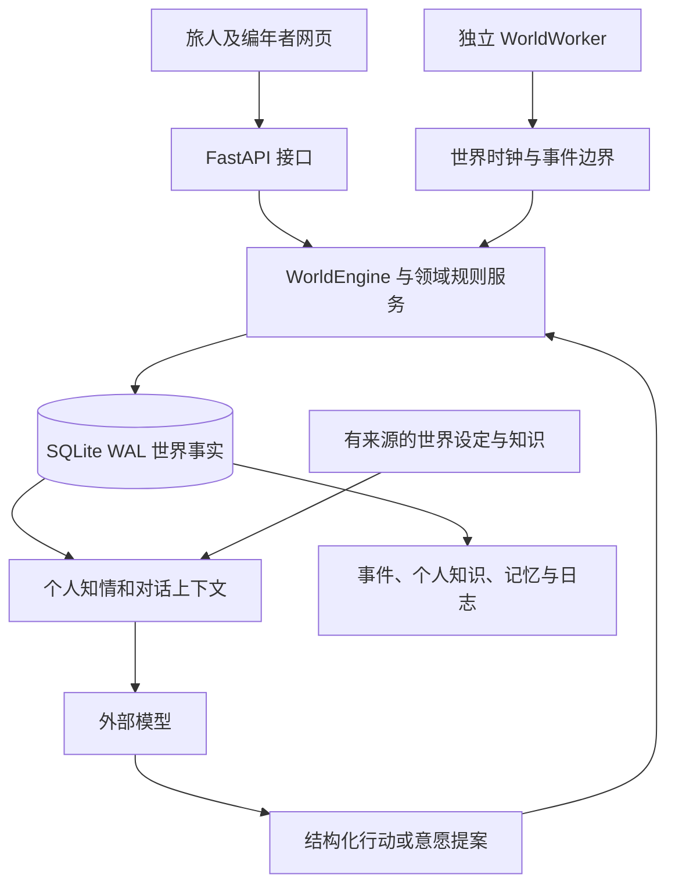

# Virtual_World 项目梳理

核对日期为 2026 年 11 月 17 日。依据为 D 盘当前源码、正式存档只读统计、设计文档和已有验收报告。

## 项目目标与当前阶段

项目目标是让用户在同一个持续保存的文字世界中生活，与已有 NPC 结识、交流、建立双方认可的关系、同行、分离和重逢。人物的资源、日程、记忆、知识与选择分别保存，行为需要产生可追溯的实际后果。

目前已经形成较完整的世界模拟内核和多条生活、关系、旅行流程。主要推进重点是统一实际操作入口、完善正式世界中的内容与空间事实，并完成连续体验验收。

用户此前确定的开发顺序是先贯通主要功能骨架，再深化细节。后续验收宜以既有 NPC 的完整相处过程为主线。[目标与验收](D:/Virtual_World/docs/design/44-encounter-companionship-goal.md)

## 当前项目位置与工程规模

| 项目 | 当前核对结果 |
| --- | --- |
| 正式代码项目 | `D:\Virtual_World` |
| 本次开发和验证副本 | `C:\Users\User\Desktop\Virtual_World\local_route_work` |
| Python 工程 | 231 个文件，约 8.13 万行 |
| 前端 | 原生 JavaScript、HTML、CSS，分别有 22、2、2 个文件 |
| 测试目录 | 230 个 `test_*.py` 文件 |
| 正式数据库 | `D:\Virtual_World\data\world.db`，约 2.91 GB，另有约 261 MB WAL |
| 数据库现状 | 收尾迁移后 292 张表，1 个世界 |
| Git 状态 | 3262 项文件状态，102 项修改、3160 项未跟踪 |

Git 状态中 `.context` 占 2891 项，业务源码和测试也有较多待纳入版本管理的文件。当前工程需要形成清晰的版本检查点，并将开发产物、验证证据和实际源码分别整理。现有记录和用户改动应在分类后处理。

## 核心运行方式

SQLite 保存客观事实。模型调用在写事务外进行，结构化结果进入领域规则，再由事务内的最新状态核验和结算。`world.version` 用于并发与状态修订。

API 提供接口与同源静态页面。独立 worker 按当前配置每 60 秒唤醒，结合世界流速和事件边界推进移动、活动、日常生活和其他领域。重启时会处理离线时间基准。[运行架构](D:/Virtual_World/docs/ARCHITECTURE.md)

实际写入入口分布在 `ActionService`、`MovementService`、`LifeActivityService`、关系和旅行等领域服务中。架构文档中“所有动作必经 ActionService”的描述需要收窄，维护时应核对每条真实调用链。

## 功能模块地图

| 领域 | 主要代码 | 已有能力 |
| --- | --- | --- |
| 运行与数据 | `api.py`、`engine.py`、`clock.py`、`worker.py`、`database.py`、`migrations.py`、`repository.py` | 世界时间、心跳、版本控制、事务、持久化、存档迁移和世界包校验 |
| NPC 认知与对话 | `conversation/context.py`、`conversations.py`、`epistemics.py`、`knowledge.py`、`intent_parser.py`、`roleplay.py`、`outreach.py` | 知情范围、记忆和会话摘要、BM25 检索、结构化意图、主动联系与沉默 |
| 生活与生计 | `life.py`、`interiors.py`、`inventory.py`、`economy.py`、`food.py`、`contracts.py`、`daily_life.py`、`npc_agency.py` | 持续活动、房间与访问权、真实库存、工作制作、食物保鲜、住房契约和 NPC 日常目标 |
| 关系与共同生活 | `intimacy.py`、`relationship_continuity.py`、`families.py`、`shared_life.py`、`appointments.py`、`appointment_series.py`、`shared_plans.py` | 关系提议与接受、边界和私人感受、家庭、共同筹备、见面改期补约、周期相处 |
| 同行与旅行 | `companions.py`、`companion_proposals.py`、`journeys.py`、`group_journeys.py`、`rides.py`、`overnight.py`、`separate_stays.py`、`lodging_plans.py` | 短时同行、NPC 领队、多人旅行、共乘、暂停恢复、交接、住宿及休息后会合 |
| 地理与通行 | `routing.py`、`movement.py`、`navigation.py`、`spatial.py`、`player_steering.py`、`cross_layer.py`、`local_routes.py` | 地形规划、折线移动、路线损坏防护、车辆位置、受限跨层及已审核局部通路 |
| 世界登记与建设 | `registration/`、`elements.py`、`removal.py`、`world_pack.py` | 严格候选类型、来源事件、幂等确认、建设结算、目录和生命周期管理 |
| 科研与技术 | `science_programs.py`、`science_runner.py`、`collective_research.py`、`principle_runner.py`、`science_freeze.py` 等 | 程序提案、预演、测量结算、证据传播、原理评审、技术图谱、预算与冻结归档 |

Web 位于 `world_engine/web`，分为旅人体验和编年者管理入口。Windows 启动入口为 `scripts/start_world.ps1`，配置由 `config.py` 与项目 `.env` 读取。当前数据库、世界包、日志和媒体路径均解析到 D 盘项目。

科研已有较大的专门子系统，当前研究、科学和集体模式的 API 开关均为关闭。其完成情况需要结合具体独立实验报告判断。

## 正式世界的实际状态

| 项目 | 本次只读结果 |
| --- | --- |
| API、worker 与监听 | 本轮收尾已启动，8765 健康验收通过 |
| 收尾快照的世界时间 | `2040-04-11T08:30:50.452054+00:00`，随后持续推进 |
| 人物 | 1887 位 NPC 和 1 位玩家 |
| 全体人物种族 | human 1884 位，dwarf、elf、goblin、orc 各 1 位 |
| 亲密关系、家庭、约会、共同相处和筹备 | 相应记录均为 0 |
| 双人和多人旅行、共乘、住宿及跨层 | 相应记录均为 0 |
| 短时同行历史 | 3 条 |
| 真实见面场次 | 1 条 |
| 觅食搜索受阻 | 339 位 NPC |
| 饱食不高于 10 的存活 NPC | 374 位 |
| 正式库局部道路表 | 已完成迁移，验收时为 0 条道路 |

上表关系、旅行、种族与生计数据读取于本轮启动前。这些数据说明，现有能力主要在隔离验收世界中获得验证，正式世界中的关系与旅行体验仍有很大展开空间。种族差异的内容数量也较少，适合优先深化已有代表人物及其真实行为。

339 位受阻 NPC 的问题涉及地图和资源尺度。先前核查显示他们距所属城镇中心约 120 米，而现场采集范围为 100 米，粗粒度水域格又阻断了走近中心的路线。地点中的食物为聚合库存，进一步解困需要实际通路或更精确的资源地点事实。

## 最新局部通路版本

局部通路代码已经应用到 D 盘项目。编年者可以提交已有勘察来源和实际折线，候选经明确确认后参与目标移动。路径保存几何、方向、速度、来源和状态版本，途中关闭会在实际进入或占用路段时处理，并衔接同行、旅行和共乘状态。

首版每次规划支持一条完整局部通路及两端通过地形验证的连接。多条局部道路的自动串联仍待扩展。确认流程沿用项目现有的本地编年者管理接口信任边界。[局部通路服务](D:/Virtual_World/world_engine/local_routes.py)

最新证据分别为 33 个相关文件、597 项固定版本整合测试通过，以及部署后从 D 盘实际源码运行的 15 个文件、223 项测试通过。界面验证覆盖 8 个脚本模拟场景。全仓 230 个测试文件的本轮统一运行记录仍待建立。

存档一致性备份及副本迁移预演已完成，本轮收尾已通过正常启动应用正式迁移。API、worker、新接口、静态资源和实际提交心跳均已验收。运行快照及接续事项见 [项目交接](D:/Virtual_World/HANDOFF.md)。[597 项回归](C:/Users/User/Desktop/Virtual_World/local_route_work/run/local-route-regression-20261116T105228Z-78000fb3.json) · [部署后核验](C:/Users/User/Desktop/Virtual_World/local_route_work/run/post-local-route-deployment-83ddde28f64d476c9715c4e5edacb3af.json) · [迁移预演](C:/Users/User/Desktop/Virtual_World/local_route_work/run/local-route-migration-20261116T104425Z-d897efd6.json)

## 已确认的流程差异

### 移动入口的规则需要统一

`execute_approach_action` 在百米可见范围内核对目标、精力和空闲后，直接把玩家坐标更新到目标位置。这条路径使用精力结算，当前没有进入路线规划和持续行走时间结算，因此可以绕过地形与局部通路的通行检查。[直接坐标更新](D:/Virtual_World/world_engine/player_action_flow.py:421)

方向键移动使用小段地形采样，当前尚未读取 `world_local_routes`。同一条已核实通路可以被目标移动使用，方向移动仍可能被粗水域格阻挡。[方向移动](D:/Virtual_World/world_engine/player_steering.py:194)

### 赠物与接收意愿需要明确产品规则

赠物会核验距离、所有权和库存，然后先转移物品，再生成或调度 NPC 反应。NPC 事前接受的流程尚未接通。后续应明确哪些赠物需要对方先行接受，以及拒收、归还和未回应时如何保存状态。[赠物转移](D:/Virtual_World/world_engine/player_action_flow.py:331)

### 连续体验验收仍有缺项

| 原目标 | 当前剩余重点 |
| --- | --- |
| 自然结识和重逢 | 稳定的自主接触、跨日重逢与真实模型连续样本 |
| 个性、文化和种族差异 | 更多人物的一致性、明确拒绝与长期个人例外 |
| 长期生活 | 两个世界年的完整多人物连续验收 |
| 共乘 | 有限燃料的实际行驶消耗、耗尽与补给恢复、救援及真实 NPC 成功样本 |
| 跨层同行 | 多人、其他转换通道及复杂行程接续 |
| 地理内容 | 可信的局部通路、精确资源地点及多条道路串联 |

已有燃料规格和装卸机制，定义有限燃料的车辆目前仍受出发门禁约束。当前跨层基础支持两人分别选择使用已建成公共升降通道，原有旅行的衔接需要继续扩展。[燃料出发边界](D:/Virtual_World/world_engine/movement.py:27) · [跨层流程](D:/Virtual_World/world_engine/cross_layer.py:82)

## 建议推进顺序

1. 统一靠近、目标移动和方向移动的时间、地形与道路规则，覆盖普通玩家的真实操作入口。
2. 本轮局部通路的正式迁移和服务验收已经收尾，后续按新版本维护对应证据和运行记录。
3. 核实代表性受阻地点的实际通路或资源位置，先完成少量真实解困过程，再扩展到更多地点。
4. 选用现有 NPC，完成相识、交谈、双方选择、同行、分离、跨日重启、重逢和关系承接的完整体验。分别保存模型接受、拒绝、反提和沉默结果。
5. 按现有总目标补人物差异、有限燃料共乘、复杂跨层和长期连续验收。
6. 分类整理 Git 中的源码、测试、开发产物与历史证据，建立可复现的版本检查点，并更新 README 与架构文档中的历史状态。

其中前四项直接影响当前可玩性。科研与更多世界扩展适合维持各自独立的验证范围和预算，使主体验进度能够持续衡量。

## 阅读入口

- 项目总说明与启动方式。[README](D:/Virtual_World/README.md)
- 运行、数据和模型边界。[架构文档](D:/Virtual_World/docs/ARCHITECTURE.md)
- 生活体验阶段记录。[生活路线](D:/Virtual_World/docs/design/16-lived-world-roadmap.md)
- 邂逅与同行的原始总目标及阶段证据。[目标与验收](D:/Virtual_World/docs/design/44-encounter-companionship-goal.md)
- NPC 需要、错约与再次联系。[需要与重逢](D:/Virtual_World/docs/design/51-npc-needs-and-reunion.md)

这些文档包含不同日期的阶段记录。判断当前状态时，应以实际源码、当前存档和对应版本的验收证据相互核对。
