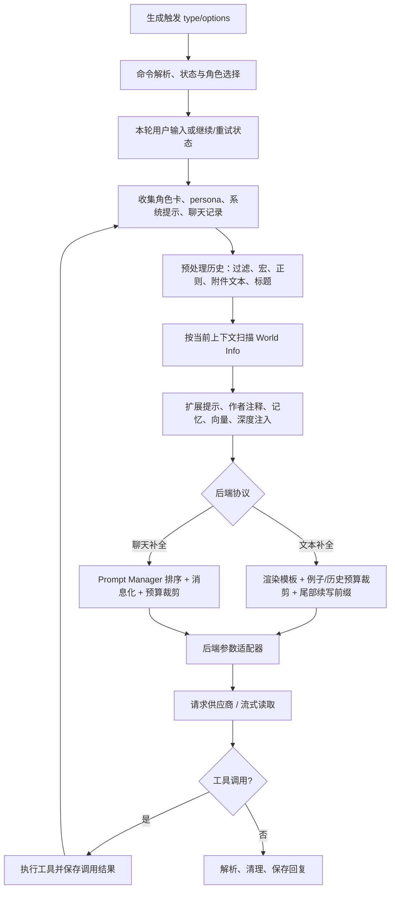

# SillyTavern 上下文组装与生成参数管线：Python 移植规格

> 目标读者：准备在独立 Python 项目中复现 SillyTavern（本目录版本 1.19.0）“选择上下文 → 组织提示 → 预算裁剪 → 生成请求 → 消费响应”的开发者。
>
> 范围：聚焦 `Generate()` 所驱动的文本补全与 Chat Completion 管线。SillyTavern 全仓库还包含用户体系、文件上传、图片生成、语音、插件、前端界面等，不属于本规格。模型供应商持续变化；供应商兼容规则需以目标版本源码及其 API 文档校准。

## 1. 复现目标与兼容等级

所谓“相同效果”至少有三个层级，应在实现前明确：

1. **语义兼容**：同一角色、历史和设置会影响模型输入的同类内容；裁剪/继续/重试语义一致。
2. **请求结构兼容**：messages/prompt 的角色、次序、字段、参数与适配器输出一致。
3. **字节级/Token 级兼容**：在同一输入下 prompt 字节串、token 计数、请求 JSON 和最终裁剪结果完全一致。

前两级可用合理的 Python 数据模型实现。第三级还要求复现 SillyTavern 的 tokenizer 选择、模板解析、宏与正则语义、角色卡格式、World Info 规则、Prompt Manager 顺序、扩展注入、各供应商兼容表；不能仅凭高层描述保证。本文把核心顺序和边界写为可实现契约，并指出必须移植或替换的外部机制。

## 2. 总体数据流



核心实现入口与证据位置：

- `public/script.js::Generate()`：本轮状态、上下文准备、文本补全拼接、后端分流、请求与响应主生命周期。
- `public/scripts/world-info.js::getWorldInfoPrompt()` / `checkWorldInfo()`：世界信息匹配与结果分类。
- `public/scripts/openai.js::prepareOpenAIMessages()`、`preparePromptsForChatCompletion()`、`populateChatCompletion()`：聊天补全上下文。
- `public/scripts/openai.js::createGenerationParameters()`、`sendOpenAIRequest()`：Chat Completion 参数和发送。
- `public/scripts/textgen-settings.js::getTextGenGenerationData()`：Text Generation WebUI 参数入口。
- `src/endpoints/backends/chat-completions.js` 及其他 `src/endpoints`：服务端供应商代理/协议适配。

## 3. 输入、状态和输出数据模型

Python 移植不要让整个管线直接读写全局变量。将可观察状态显式化：

```python
@dataclass
class GenerationRequest:
    kind: str                 # normal/continue/regenerate/swipe/impersonate/quiet
    text: str = ""
    automatic: bool = False
    quiet_prompt: str = ""
    quiet_to_loud: bool = False
    skip_world_info_and_author_note: bool = False
    dry_run: bool = False
    json_schema: dict | None = None
    recursion_depth: int = 0

@dataclass
class Message:
    role: str                  # user/assistant/system/tool
    text: str
    name: str | None = None
    is_user: bool = False      # legacy chat model may need this separately
    is_system: bool = False
    media: list = field(default_factory=list)
    tool_invocations: list = field(default_factory=list)
    metadata: dict = field(default_factory=dict)

@dataclass
class ContextInputs:
    character: dict
    persona: dict
    chat: list[Message]
    world_books: list[dict]
    examples: list
    extension_prompts: list[dict]
    settings: dict
    backend: str
    model: str
    tokenizer: object
```

实际输出分为：

- `PromptTrace`：解释每段内容来源、位置、是否计入 token、是否最终保留。对应原项目的 itemized prompt/debug 观测能力。
- `TextCompletionPayload`：`prompt` 加后端专用字段。
- `ChatCompletionPayload`：有序 `messages` 加模型参数。
- `GenerationResult`：增量文本/完整文本、推理内容、工具调用、图片/元数据、错误状态。

消息正文与附加信息应分开保存；不要把展示用的媒体标题、工具调用元数据误当成纯文本而丢失。

## 4. 阶段 0：生成类型和聊天状态变更

`Generate(type, options, dryRun)` 开始后，先发出开始事件并确保角色卡已加载。命令解析发生在普通生成路径；斜杠命令可能接管输入并中止本次生成。随后检查后端状态、停止状态、流式能力等前置条件。

各类型对聊天状态的影响：

| 类型 | 用户输入 | 末尾助手消息 | 特殊语义 |
|---|---|---|---|
| `normal` | 读取输入框并通常先写入聊天 | 新增回复 | 正常附件可附加 |
| `continue` | 不新增用户输入 | 当前助手文本作为待续写前缀 | 不加普通结束分隔；时间统计承接原生成 |
| `regenerate` | 不新增用户输入 | 移除/替换当前助手回复 | 对应 prompt/swipe 元数据也需一致维护 |
| `swipe` | 不新增用户输入 | 从本次上下文排除当前候选 | 创建新候选回复 |
| `impersonate` | 不按普通用户消息写入 | 目标是生成用户口吻内容 | 禁止某些角色名前缀；专属预填充 |
| `quiet` | 不创建普通对话轮次 | 结果由调用方消费 | 通常不流式显示；附加 quiet 指令 |

`dry_run=True` 应只组装和计数，不触发模型调用、不提交新聊天消息。组群逻辑会分派到每个启用角色，生成上下文可能随当前发言角色变化；若要求群聊兼容，必须在管线外层建模成员轮转。

## 5. 阶段 1：获取、替换角色设定和系统提示

读取当前角色卡字段：描述、性格、场景、示例对话、系统提示、jailbreak/PHI、深度提示、创建者注释等，并同时读取用户 persona、用户/角色名字、全局系统提示和后端设置。

处理约束：

1. 执行 SillyTavern 宏替换（如用户名、角色名、角色字段、聊天状态等）。宏依上下文有普通/扩展版本，不等同于简单 `str.replace`。
2. 角色卡可在设置允许时覆盖主提示和 jailbreak；提示管理器还能禁止覆盖或禁用某条提示。
3. 非 Chat Completion 路径的系统提示可能由全局设置启用/关闭，并依“偏好角色提示”决定用角色卡内容替换系统提示模板。
4. instruct 模式只对非 OpenAI 主 API 生效；聊天补全使用自己的主提示模板和消息结构。
5. persona 可配置在主提示中或聊天深度位置，不应无条件重复注入。

移植时建议单独实现 `MacroResolver`，并明确缺失字段、递归宏、未知宏、时间/聊天变量和安全转义策略。若要求与 ST 完全一致，需从 `public/scripts/macros/` 移植宏语法及其运行时上下文。

## 6. 阶段 2：聊天历史预处理

预处理顺序会影响 World Info 扫描和 token 结果，建议明确分两个视图：原始历史与生成视图。

### 6.1 构造 core history

- 过滤消息：普通系统消息通常排除；具有工具调用信息的系统/工具消息在工具能力启用时可保留。
- `swipe` 本轮从末尾排除当前回复。
- 对首条消息做参数替换，以反映当前角色/persona 设置。
- 对每条消息调用提示词位置的正则替换：user 使用用户输入规则，assistant 使用 AI 输出规则；`depth` 通常按消息距离最新位置计算。
- 附加文件内容；对于设置为追加标题的消息/媒体，把标题追加到正文供模型阅读。
- 推理信息按工具/供应商能力和组聊当前角色等规则决定是否纳入。

### 6.2 写入当前用户输入

普通非自动触发消息在构造上下文前加入 chat。待上传附件只对允许的类型加入；regenerate、swipe、impersonate、quiet、continue 不按普通方式附带待处理文件。

偏置字符串由输入和生成类型计算：

- `messageBias` 可随用户消息作为附加元数据或系统消息。
- `promptBias` 可能被加入本轮生成尾部。
- `isUserPromptBias` 会影响是否强制追加角色名称。

若只有 bias、没有有效正文，普通消息处理可能创建空格系统消息来承载 bias。后端 OpenAI 路径另有 `send_if_empty`：聊天末尾是 assistant 且配置有替代文本时，预算允许则插入 user 消息。

### 6.3 多模态内容

聊天记录的 media 不是始终转换成文本。Chat Completion 在供应商/模型支持时将 image/video/audio 以内联内容块加入消息；不同供应商支持集合不同。文本补全路径可把附件抽取文本和可追加标题并入 prompt，但不能假定二进制媒体可直接被普通字符串模型理解。

如目标 Python 项目只支持文本，必须将这点写成兼容性差异；如要多模态一致，需保留内容块、媒体类型、显示模式（列表/画廊及选中项）和提供方能力判定。

## 7. 阶段 3：World Info 扫描

World Info 是上下文检索阶段，不是固定角色卡文本。输入包括按扫描逻辑准备的聊天文本、角色资料及全局扫描信息；消息名称是否并入扫描文本受 `world_info_include_names` 设置影响。触发类型也会传给扫描逻辑。

扫描可能受这些设置影响：

- 关键词大小写、整词匹配、策略和递归扫描。
- 最大递归步数、最小激活数、深度最大值。
- 世界条目预算与预算上限、条目优先级/评分等。
- 群聊评分和启用的世界书集合。
- 角色/聊天相关的条目匹配和缓存。

输出不只是一个字符串：`worldInfoBefore`、`worldInfoAfter`、例子条目、深度条目、作者注释前后条目及 outlet 条目分别进入后续通道。深度注入和 outlet 还受 skip-WIAN 选项影响。

**完全复现风险最高的子系统之一。** Python 移植需要移植 `checkWorldInfo()` 的完整匹配、递归、预算、排序、缓存和位置语义；仅将关键词对最新用户消息做一次 substring 搜索不等价。源代码入口为 `public/scripts/world-info.js::getWorldInfoPrompt()`，具体实现继续追 `checkWorldInfo()` 及其所调用的排序/激活函数。

## 8. 阶段 4：例子、作者注释和扩展提示

### 8.1 示例对话

- 解析角色卡示例格式，替换模板变量，按当前 instruct 模式格式化。
- World Info 触发的示例可插到示例数组前端或末端，位置由条目锚点指定。
- `strip_examples` 可清空示例集合。
- `pin_examples` 将示例视为预算优先项；否则仅加入能放入上下文预算的示例。
- Chat Completion 将每段示例转成示例消息，并在配置了 `dialogueExamples` 提示时插入；每段示例必须整体可负担，不能只加半个示例轮次。

### 8.2 作者注释 / Floating prompt

作者注释可来自当前聊天元数据或角色/全局设置；World Info 也可能向其注入内容。它可放在主提示前/后、聊天指定深度或由提示管理器重排。不同 API 对其默认位置和角色的表达不同。

### 8.3 扩展提示接口

扩展提示至少要携带：`id`、`text`、`position`、`depth`、`role`、`priority/order`、可选 filter。常见来源包括记忆总结、向量检索、数据银行、ChromaDB、角色深度提示、作者注释和插件注入。

文本补全通常把这些按深度附在某条历史消息之前/之后，或作为主提示前/中内容。Chat Completion 将相对位置提示插入主提示附近，将绝对位置提示按消息深度注入历史；同一深度通常按 priority 分组，并按 role 合并成注入消息。排序细节见 `openai.js::populationInjectionPrompts()`。

移植建议定义一个后端无关的有序 Prompt IR，而非在扩展代码里直接改最终字符串：

```python
PromptSegment(
    id="memory", text="...", role="system",
    placement="before_main|after_main|in_chat|absolute",
    depth=2, order=100, required=False, source="extension:memory",
)
```

## 9. 阶段 5A：文本补全 prompt 构造算法

### 9.1 故事字符串（story string）

`renderStoryString()` 根据所选上下文模板渲染角色描述、性格、persona（若位置为 in-prompt）、场景、系统提示、World Info 前/后、提示锚点、示例等。instruct 模式会再调用 `formatInstructModeStoryString()`。

Story string 可作为顶部主设定，或依设置转成聊天深度注入；转成深度注入后必须清空顶部 story string，避免重复。

### 9.2 历史格式与上下文窗口

- 用 `formatMessageHistoryItem()` 将角色消息转换为文本补全格式；instruct 模式选择对应 user/assistant 序列。
- `continue` 对末尾待续写消息不添加普通输出结束序列，并保留 `cyclePrompt`。
- 先预留深度注入，再按上下文限制纳入可用聊天历史。
- 控制用户对齐消息是否需要出现在最前端/历史上下文，避免模型以错误角色开口。
- 示例按 pinned/可选规则纳入；最终超限时先删可选示例，再从最旧历史开始裁剪。
- 拼接前按设定处理换行、聊天 preamble、聊天分隔符和 collapse-newlines。

### 9.3 尾部控制提示

在普通非 instruct prompt completion 下，可追加 `角色名:`。impersonate 使用用户名称。instruct 模式用输入序列、输出序列、角色名和 quiet 语义格式化。Quiet prompt 可能早退，避免后续常规角色响应格式覆盖它。prompt bias 在文本补全路径可追加到最终消息尾部；CFG 提示可按 depth 插入或附加在末尾。

### 9.4 token 预算与停止条件

需要给 tokenizer 一个统一接口：

```python
async def count_tokens(segments: list[PromptSegment], padding: int = 0) -> int: ...
```

ST 的计数受后端 tokenizer、模型、模板和 token padding 影响；不能仅用字符数/4 假装等价。对上下文字符串，程序会计入 story、示例、对齐消息、聊天历史、末尾生成格式和 cycle prompt。达到/超过 `max_context` 时停止继续加入较旧历史。最终组合还要再算一次，以处理注入和模板开销。

配置 `max_context` 与 `max_new_tokens` 需一致处理：一些后端会自动减少回复长度；Horde 等路径可按服务端实际限制调整 `maxLength`、`maxContextLength`，并设定最小长度防止请求校验失败。

## 10. 阶段 5B：Chat Completion messages 构造

### 10.1 准备 Prompt 集合

`preparePromptsForChatCompletion()` 构造有 identifier 的 Prompt：World Info 前/后、主提示、角色描述、性格、场景、impersonation、quiet、群聊提示、bias、persona、记忆、作者注释、向量/数据银行/智能上下文和通用扩展提示。

提示管理器的集合可覆盖这些项的 role、injection position、depth、order，并控制启停。角色卡覆盖 main/jailbreak 还要检查该提示是否禁用和 `forbid_overrides`。

World Info 可以经供应商格式化（`wi_format`）。scenario/personality 可以分别应用 `scenario_format` / `personality_format`。提示内容可能再过模板宏替换。

### 10.2 填充顺序与预算

`prepareOpenAIMessages()` 创建 `ChatCompletion`，配置两个重要预算：最大上下文和最大生成 token 数。随后 `populateChatCompletion()`：

1. 为 assistant 回复 priming 预留 token。
2. 加入 World Info、主提示、角色资料和 persona。
3. 准备 impersonation/quiet 等控制提示并为其预留预算。
4. 追加按提示集合排序的 nsfw、jailbreak、用户相对位置等提示。
5. 添加 bias 和可插在主提示前/后的扩展内容。
6. 为工具 schema 预留 token（当前类型允许工具时）。
7. 处理 continue-prefill 或 continue-nudge。
8. 按 absolute prompt 的深度注入聊天消息。
9. 在预算允许范围内从最新历史向旧历史加入消息；工具调用及结果作为成组内容加入，避免断开 tool-call/result 关系。
10. 根据 pin_examples 决定例子与历史谁优先。
11. 释放先前预留的控制提示预算后，将控制提示放到配置位置。

`ChatCompletion.canAfford()` / `canAffordAll()` 是关键语义：消息只有在预算能容纳时才加入；历史迭代由新到旧，无法容纳时停止，不跳过一个太大的旧消息再尝试更老消息。固定提示超过预算时会报“Mandatory prompts exceed context size”，而不是悄悄删掉必需系统提示。

### 10.3 名称、媒体与工具历史

- names_behavior 配置为 completion 时，消息 name 会验证/清洗后传入。
- image/video/audio 仅当提供方声明支持时以内联块添加。
- 画廊模式只内联当前选中媒体；列表模式按列表加入。
- 工具调用作为 assistant tool-call + tool result 消息组处理，预算不足时整组停止加入。
- reasoning signature、工具推理文本按供应商能力和 reasoning mode 过滤。
- 组聊 nudge 只在群聊且类型允许时加入；impersonate 禁止群聊 nudge。
- continue 有两种路径：prefill 支持时把待续写消息移至控制提示并可附 assistant prefill；否则构造带上轮内容的 continue nudge。

## 11. 阶段 6：生成参数和供应商适配

参数层必须拆分为两部分：**标准生成意图**与**供应商 wire payload**。不要让 prompt builder 在所有地方直接拼供应商字段。

```python
@dataclass
class SamplingIntent:
    temperature: float | None
    top_p: float | None
    top_k: int | None
    frequency_penalty: float | None
    presence_penalty: float | None
    repetition_penalty: float | None
    min_p: float | None
    top_a: float | None
    seed: int | None
    stop: list[str]
    max_output_tokens: int
    stream: bool
    reasoning_effort: str | None
```

Chat Completion 基础 payload 包括 `type, messages, model, temperature, frequency_penalty, presence_penalty, top_p, max_tokens, stream, logit_bias, stop, chat_completion_source, n, names, reasoning_effort`，并可选加入工具、网页搜索、图像生成/分辨率/宽高比、verbosity、JSON Schema、代理及供应商元数据。

参数步骤：

1. 校验 messages 是数组；过滤空值和非对象项。
2. 取所选 source 对应 model。
3. 依据 source/model/type 判定流式、multi-swipe、seed、logprobs、logit bias、代理和工具能力。
4. 从 UI/settings 转换数值类型，必要时 clamp（例如某些供应商 top-p 或 temperature 范围）。
5. 附加 source 专属字段。
6. 根据模型拒绝字段清单删除不支持参数/字段组合；必要时重命名 max token 参数、修改 role。
7. 附加 JSON Schema（只在支持的路径）。
8. 发出 settings-ready 事件，允许扩展最后观察/修改对象。

特别注意：**兼容表是动态产品逻辑**，必须按版本移植，不能假定“OpenAI-compatible”就支持完全相同的参数。例如当前源码针对 Claude、OpenRouter、Google/Vertex、Cohere、Perplexity、Groq、DeepSeek、xAI、Workers AI、MiniMax、Moonshot、OpenAI 新模型等分别加字段、限制范围或删除参数。完整源列表和具体 if 条件在 `createGenerationParameters()`；移植时最稳妥做法是保留逐供应商策略表并为每个模型系列建立 fixture。

文本补全参数同样由后端适配器生成：Kobold GUI/preset 两种模式、TextGen 参数模板、NovelAI preset、CFG 正/负提示等。不要把 Chat Completion 参数规则套给文本补全。

## 12. 阶段 7：发送、流式/非流式响应、工具循环

### 12.1 发送

Chat Completion 前端请求 `POST /api/backends/chat-completions/generate`，请求体是参数对象 JSON，并带会话/CSRF 请求头和 AbortSignal。服务端 endpoint 按 source 选择供应商处理逻辑，保护凭证不暴露给浏览器，并处理流转换或错误。

文本补全也按 `main_api` 走相应 endpoint。移植到 Python 时可把供应商 client 封装成 adapter；将凭证只存服务端。

### 12.2 流式响应

流式路径将响应体解码成事件流，逐块读取。前端会维护累积文本、推理文本、图片/签名、工具调用等状态，经过 `StreamingProcessor` 更新界面。abort/stop 会取消当前请求或读取任务。

非流式路径解析完整 JSON，提取正文、推理、标题、图片、多候选结果和错误信息。两条路径最后都应汇入同一个 `GenerationResult` 处理逻辑，避免不同清洗规则造成不一致。

### 12.3 工具调用递归

若本轮允许工具，且模型返回工具调用：

1. 解析调用并检查是否为已注册工具。
2. 执行工具，记录调用参数、结果、错误和 reasoning 信息。
3. 保存 assistant 工具调用与 tool 结果到聊天历史。
4. 对“只有工具调用没有用户可见正文”等场景决定是否删除空中间回复。
5. 增加递归 depth，再次生成，将工具结果包含在新上下文中。
6. 达到递归上限、工具错误或 stealth 工具要求停止时结束本轮。

Python 重现时要避免工具结果只存在于运行时变量、不进入下一轮 messages；否则模型无法基于工具输出作答。

## 13. 建议的 Python 模块边界

```text
pipeline/
  models.py             # request/message/context/payload/trace 数据类
  lifecycle.py          # normal/continue/regenerate/swipe/quiet 状态转换
  macros.py             # 宏解析和上下文变量
  transforms.py         # regex、文件文本、媒体标题和消息清洗
  world_info.py         # 匹配、递归激活、评分、预算和位置分类
  examples.py           # 角色卡/WI 示例解析、排序与格式化
  extensions.py         # 注入接口、role/position/depth/order/filter
  token_budget.py       # tokenizer 接口、预留/释放、可负担检查
  text_prompt.py        # story string、history、instruct、尾部格式
  chat_prompt.py        # Prompt IR、prompt manager、messages、工具历史
  adapters/
    base.py
    kobold.py
    textgen.py
    novelai.py
    openai_compatible.py
    provider_*.py       # 供应商能力表/模型例外
  transport.py          # HTTP、流式 SSE、取消、错误映射
  response.py           # 正文抽取、清理、持久化、工具循环
```

关键设计原则：

- 每个阶段输入/输出不可变或复制，避免 `continue`、重试修改共享历史原对象。
- 每个 segment 保留 source/id/position/token count，才能生成可比的 prompt trace。
- 后端能力通过声明式 `ProviderCapabilities` 和精确的 model override 表驱动，不散落在 prompt builder。
- tokenizer、宏、模板、World Info、regex 必须可替换并可配置版本。
- 区分“必需提示”和“可裁剪提示”；预算不够时不可默默删除系统安全/角色主提示。

## 14. 参考伪代码

```python
async def generate(req, state):
    state = await apply_type_transition(req, state)
    if not req.dry_run:
        await ensure_backend_available(state.backend)

    raw = collect_character_persona_system_and_chat(state)
    history = preprocess_history(raw.chat, req, state.settings)
    wi = await scan_world_info(
        history_for_scan(history, include_names=state.settings.wi_include_names),
        character_fields=raw.character_fields,
        trigger=req.kind,
        budget=state.settings.world_info_budget,
    )
    examples = parse_and_merge_examples(raw.examples, wi.examples, state.settings)
    extensions = await collect_extension_prompts(raw, wi, history, req)
    ir = render_context_ir(raw, wi, examples, history, extensions, req, state.settings)

    if state.backend in TEXT_COMPLETION_BACKENDS:
        selected = await fit_text_context(ir, tokenizer=state.tokenizer,
                                          context_limit=state.max_context,
                                          pin_examples=state.settings.pin_examples)
        prompt = render_text_prompt(selected, instruct=state.instruct,
                                    generation_type=req.kind,
                                    bias=state.prompt_bias)
        payload = state.adapter.build_text_payload(prompt, state.settings, req)
    else:
        messages = await build_chat_messages(ir, prompt_manager=state.prompt_manager,
                                             tokenizer=state.tokenizer,
                                             context_limit=state.max_context,
                                             output_reserve=state.max_output_tokens,
                                             pin_examples=state.settings.pin_examples)
        payload = state.adapter.build_chat_payload(messages, state.settings, req)

    trace = make_prompt_trace(ir, payload)
    if req.dry_run:
        return trace

    result = await state.adapter.generate(payload, signal=state.abort_signal)
    if result.tool_calls and may_call_tools(req, state):
        tool_messages = await execute_and_serialize_tools(result.tool_calls)
        state.chat.extend(tool_messages)
        return await generate(req.with_kind("normal").increment_depth(), state)

    final = normalize_result(result, req, state)
    await persist_chat_transition(final, req, state)
    return final
```

这是模块边界参考，不是声称逐行等于 JS。要实现 source parity，应把每个步骤按本规格对应到源码行为，并用下节的差分测试固定实际输出。

## 15. 差分测试与验收标准

不要以“API 有回复”作为管线兼容的充分验收。建立固定输入 fixture，记录 JS 参考输出：

1. 原始角色卡、persona、设置、World Info、扩展提示和消息历史。
2. 预处理后的消息序列（包括每条 regex/宏/附件标题结果）。
3. World Info 激活条目、排序、注入位置和预算。
4. Prompt IR 每段的 id、role、position、depth、token 数和来源。
5. 最终文本 prompt 或 chat messages 的精确 JSON。
6. 参数 payload 经供应商修剪后的 JSON。
7. 模拟模型响应/工具调用后的历史状态。

至少覆盖这些场景：

- 普通一对一生成、空输入与 send-if-empty。
- 上下文刚好 fit、超 1 token、必需提示超限。
- 固定/非固定示例，World Info 示例与深度注入。
- instruct 开/关、persona 不同位置、prompt manager 禁用/重排。
- continue、regenerate、swipe、impersonate、quiet。
- 群聊禁用成员、群聊 nudge、角色深度提示。
- 附件文本、标题、多模态 list/gallery、tool-call/result 历史。
- 支持/不支持 stream、n、seed、stop、logprobs、tools 的 provider/model。
- 工具成功、工具错误、空中间回复、递归上限、请求取消。

比较策略：先比较结构化 trace 和消息字段，再比较最终序列化 JSON；tokenizer 不同会让裁剪边界不同，因此 token 计数必须采用对应 tokenizer，且固定模型版本。API 返回自然语言不适合作为确定性测试基准。

## 16. 当前项目的事实边界与迁移提示

- 项目根 `README.md` 很短，主要描述项目是面向高级用户的 LLM 前端；本文以源码为事实依据。
- 这份工作区的 package 版本显示 SillyTavern 1.19.0。用户本地设置、私有插件和运行数据可能与仓库默认不同。
- “同样效果”不能只复制生成参数；决定模型所见内容的宏、角色卡模板、World Info、Prompt Manager、扩展、tokenizer 和特殊生成类型都是管线的一部分。
- 真正跨语言复刻时，先实现可关闭扩展的核心基线，再逐模块实现差分兼容；每次增加功能都用 JS 参考快照验证，避免将实现近似误称为等价。
- 上游版本更新时需重跑 fixture。供应商能力清单尤其会变化。

## 17. 源码阅读索引

| 主题 | 源码位置 |
|---|---|
| 主生成生命周期、类型分流、上下文组装 | `public/script.js`：`Generate()`，约 4290 行起 |
| 角色卡字段与示例解析 | `public/script.js`：`getCharacterCardFields()`、`parseMesExamples()` 调用点 |
| World Info 入口与扫描设置 | `public/scripts/world-info.js`：`getWorldInfoPrompt()` 约 892 行；继续追 `checkWorldInfo()` |
| Chat Completion 提示映射 | `public/scripts/openai.js`：`preparePromptsForChatCompletion()` 约 1367 行 |
| Chat Completion 填充/预算/注入 | `public/scripts/openai.js`：`populateChatCompletion()` 约 1185 行 |
| OpenAI messages 总入口 | `public/scripts/openai.js`：`prepareOpenAIMessages()` 约 1550 行 |
| 参数能力过滤 | `public/scripts/openai.js`：`createGenerationParameters()` 约 2691 行 |
| Chat Completion 请求和流解析 | `public/scripts/openai.js`：`sendOpenAIRequest()` 约 3140 行起 |
| 文本补全请求参数 | `public/scripts/textgen-settings.js`：`getTextGenGenerationData()` 约 1844 行 |
| 服务端 Chat Completion endpoint | `src/endpoints/backends/chat-completions.js`：`POST /generate` 约 2242 行 |
| 服务端其他 provider | `src/endpoints/*.js`、`src/endpoints/backends/*.js` |

---

*本规格描述的是源码管线和 Python 移植边界，不是运行时配置指南。实现时请以目标 SillyTavern commit 的源码作为差分 oracle。*
